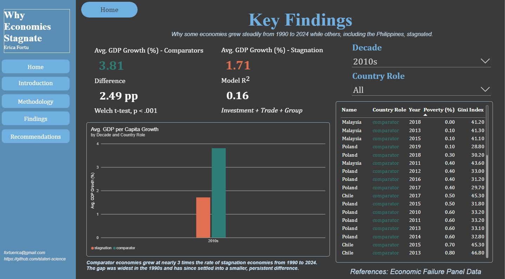

# Why Economies Stagnate

Analyzing macro fiscal drivers of long term economic stagnation in the Philippines and peer economies (1990 to 2024) using SQL, R, Excel, and Power BI.

## Research question

Why do some economies stagnate for decades while others keep growing?

## At a glance

| | |
|---|---|
| **Period** | 1990 to 2024 |
| **Stagnation group** | Philippines, Brazil, Mexico, South Africa |
| **Comparator group** | Indonesia, Vietnam, Poland, Malaysia, Chile |
| **Main outcome** | GDP per capita growth (year on year, %) |
| **Other indicators** | Gini index, poverty headcount at $2.15 a day (%) |
| **Tools** | SQL, R, Excel, Power BI |
| **Data source** | Economic Failure Panel Data |

## Key findings

* Comparator economies grew nearly 3 times as fast as the stagnation economies from 1990 to 2024.
* The average growth gap is **2.49 percentage points** (Welch t test, p < .001).
* The gap was widest in the 1990s and has since settled into a smaller but persistent difference.
* A model with investment, trade, and country group as predictors gives a Model R of 0.16, so these factors explain only part of the gap.

## Methodology

1. **Data collection and cleaning (SQL).** Compiled a country by year panel for the nine economies, then cleaned, joined, and queried the indicators.
2. **Exploratory analysis (R).** Compared GDP per capita growth between the two groups, overall and by decade.
3. **Statistical testing (R).** Used a Welch t test to check whether the difference in average growth between groups is statistically significant.
4. **Modeling (R).** Fitted a model with investment, trade, and group as predictors of GDP per capita growth.
5. **Dashboard (Power BI).** Built an interactive report with a decade slicer, a country group slicer, growth cards, a growth by decade chart, and a table of Gini index and poverty headcount by country and year.

## Dashboard

The Power BI report has these sections: Introduction, Research Question, Methodology, Pipeline, Analysis in R, Key Findings, Recommendations, and Limitations.

## Limitations

* The sample covers only nine countries, so results may not generalize to other economies.
* The model's Model R of 0.16 means most of the variation in growth is not explained by investment, trade, and group alone.
* The analysis shows association, not cause and effect.

## Repository structure

| Folder | Contents |
|---|---|
| `data` | Raw and cleaned datasets |
| `sql` | SQL scripts for cleaning and querying |
| `r` | R scripts for exploratory analysis, testing, and modeling |
| `excel` | Supporting Excel files |
| `dashboard` | Power BI report and preview image |
| `docs` | Supporting documentation |

## How to reproduce

1. Clone the repository.
2. Run the scripts in the `sql` folder to build and clean the panel dataset.
3. Run the scripts in the `r` folder in order to reproduce the analysis.
4. Open `dashboard/Dashboard.pbix` in Power BI Desktop to explore the results.

## References

* Economic Failure Panel Data

## Author

**Erica Jean Fortu**
Email: fortuerica@gmail.com
GitHub: [stateri-science](https://github.com/stateri-science)
Portfolio: https://datascienceportfol.io/fortuerica

## License

MIT License. See the `LICENSE` file.
